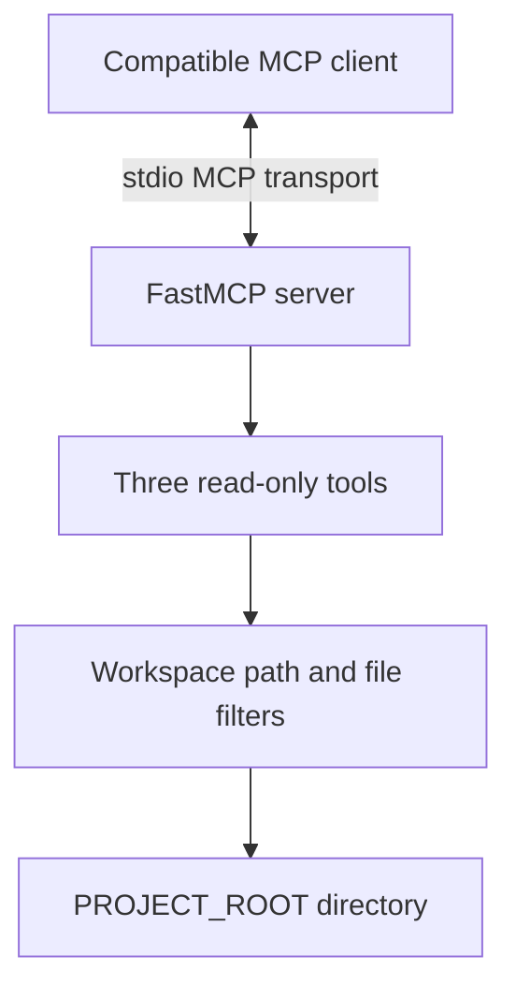

# MCP Server Developer Toolkit

A small Model Context Protocol (MCP) server that exposes read-only project-workspace tools to compatible MCP clients. It uses the Python MCP SDK's FastMCP interface and provides bounded file listing, file reading, and literal text search.

> **Scope:** This is a local developer-workspace tool server, not a general-purpose coding agent. It does not edit files, run shell commands, execute tests, or connect to GitHub. The server uses the SDK's configured stdio transport when started with `mcp.run()`.

## Tools exposed

| Tool | Inputs | Behavior |
|---|---|---|
| `list_project_files` | `limit` (1–500) | Lists eligible files under the configured workspace root |
| `read_project_file` | `path` | Reads an eligible file using a relative path |
| `search_project_text` | `query`, `limit` (1–100) | Performs case-insensitive literal line search |

Eligible extensions are `.py`, `.js`, `.ts`, `.md`, `.txt`, `.json`, `.yaml`, and `.toml`. Hidden VCS/virtual-environment/dependency folders are skipped, symlinks are excluded, and individual files larger than 500 KB are ignored.

## Architecture



## Requirements and installation

Requirements: Python 3.10+ and a compatible version of the MCP Python SDK.

```bash
git clone https://github.com/HardikPaghdar/mcp-server-developer-toolkit.git
cd mcp-server-developer-toolkit
python -m venv .venv
source .venv/bin/activate
# Windows: .venv\Scripts\activate
pip install -r requirements.txt
```

## Run the server

Set `PROJECT_ROOT` to the directory the MCP tools are allowed to inspect:

```bash
export PROJECT_ROOT="/absolute/path/to/your/project"
python -m mcp_devtools.server
```

On Windows PowerShell:

```powershell
$env:PROJECT_ROOT = "C:\\path\\to\\your\\project"
python -m mcp_devtools.server
```

The process communicates with its MCP client over stdio. Configure the client to launch this command in the repository's virtual environment and set the same `PROJECT_ROOT` environment variable. See [docs/client-setup.md](docs/client-setup.md) for the client configuration notes.

## Example project

A small sample workspace is available in [examples/sample_project](examples/sample_project).

## Security model and limitations

- Tools are read-only: there are no file-write or shell-execution tools.
- Paths must be relative and are resolved under the configured workspace root.
- Symlink access is rejected; selected file extensions and size limits reduce accidental exposure.
- Search is literal and case-insensitive, not semantic or embedding-based.
- The implementation is intended for a trusted local developer environment. It does not implement user authentication, network authorization, audit logging, or per-user workspace isolation.
- Do not point `PROJECT_ROOT` at directories containing secrets unless exposing their contents to the connected MCP client is intentional.
- A path filter is not a complete sandbox against every possible filesystem race or platform-specific edge case.

## Tests

```bash
pytest
```

The GitHub Actions workflow runs the test suite on pushes and pull requests.

## Repository layout

- `mcp_devtools/server.py` — FastMCP server and tool registration
- `mcp_devtools/tools.py` — workspace scanning, validation, reading, and search
- `tests/` — tool behavior tests
- `docs/client-setup.md` — client setup notes
- `examples/sample_project/` — sample workspace

## Related projects

- [MCP AI Developer Assistant](https://github.com/HardikPaghdar/mcp-ai-developer-assistant)
- [Codebase RAG AI Developer](https://github.com/HardikPaghdar/codebase-rag-ai-developer)
- [More projects on my portfolio](https://hardikpaghdar.netlify.app/)
